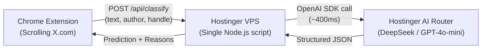

# Dnoise — Bare Minimum Hackathon Plan

## 1. The Core Verdict: Local Model vs. Hostinger AI Router

### ❌ Why you should NOT run a local model (Ollama) on the KVM 2:
* **The KVM 2 has 2 vCPU cores and NO GPU.**
* Running an LLM (like Llama 3 or Qwen) on 2 CPU cores takes **8 to 15 seconds per tweet**.
* When scrolling X/Twitter, tweets load continuously. A 10-second delay per tweet will freeze your background worker and ruin the live demo.

### ✅ What to use instead: Hostinger AI Router:
* Hostinger provides **free AI Router credits** for 150+ models.
* It runs on high-end cloud GPUs with **~300–600ms latency** (fast enough for in-feed scrolling).
* Models to use: `deepseek/deepseek-chat` or `openai/gpt-4o-mini`.
* Your backend runs on your Hostinger VPS, and the inference runs on Hostinger AI Router — **100% compliant with the challenge rules.**

---

## 2. Bare Minimum Architecture

You only need **two moving parts**:



1. **Hostinger VPS:** A single 50-line Node.js server (`server.js`) listening on port 3000.
2. **Hostinger AI Router:** Receives the tweet text, checks for propaganda techniques, and returns JSON.
3. **Chrome Extension (Already Built):** Receives the JSON, blurs the post if confidence $\ge$ 70%, shows the "PROPAGANDA" label, and displays reasons in the "Details" drawer.

---

## 3. The Backend: Complete `server.js` (Run on VPS)

Copy and run this minimal server on your Hostinger VPS.

```js
// server.js (on Hostinger VPS)
import express from 'express';
import cors from 'cors';
import OpenAI from 'openai';

const app = express();
app.use(cors());
app.use(express.json());

// Initialize Hostinger AI Router (OpenAI-compatible endpoint)
const client = new OpenAI({
  baseURL: process.env.HOSTINGER_AI_ROUTER_URL || 'https://ai-router.hostinger.com/v1',
  apiKey: process.env.HOSTINGER_AI_KEY || 'your_hostinger_ai_router_key',
});

const SYSTEM_PROMPT = `You are a social media propaganda detection system.
Analyze the tweet content and author metadata. Determine if it contains propaganda, state-sponsored bot messaging, disinformation, or psychological manipulation.

Supported categories: PROPAGANDA, PHISHING, SCAM, MISINFORMATION.

Return ONLY a valid JSON object matching this schema:
{
  "predictions": [
    {
      "category": "PROPAGANDA" | "MISINFORMATION" | "SCAM" | "PHISHING",
      "confidence": number between 0 and 1,
      "reasons": ["short bullet reason 1", "short bullet reason 2"]
    }
  ]
}

If the tweet is normal political discourse, personal opinion, or benign news, return confidence under 0.4.
If it exhibits whataboutism, coordinated disinfo talking points, or spoofed news domains, return confidence >= 0.7.`;

app.post('/api/classify', async (req, res) => {
  const { text, metadata } = req.body;
  if (!text) return res.status(400).json({ error: 'Missing text' });

  try {
    const prompt = `Tweet text: "${text}"\nAuthor: ${metadata?.author || 'Unknown'} (${metadata?.handle || ''})\nLinks: ${(metadata?.links || []).join(', ')}`;

    const response = await client.chat.completions.create({
      model: 'deepseek/deepseek-chat', // or 'openai/gpt-4o-mini'
      messages: [
        { role: 'system', content: SYSTEM_PROMPT },
        { role: 'user', content: prompt }
      ],
      response_format: { type: 'json_object' },
      temperature: 0.1,
    });

    const parsed = JSON.parse(response.choices[0].message.content);
    return res.json(parsed);
  } catch (err) {
    console.error('Classification error:', err);
    // Never crash the extension on error:
    return res.json({ predictions: [] });
  }
});

const PORT = process.env.PORT || 3000;
app.listen(PORT, () => console.log(`Propaganda backend running on port ${PORT}`));
```

---

## 4. Minimum Setup in 3 Steps

### Step 1: Run the Server on Hostinger VPS
On your VPS terminal:
```bash
mkdir pd3k-backend && cd pd3k-backend
npm init -y
npm install express cors openai
# paste server.js, then run:
export HOSTINGER_AI_KEY="your_api_key_from_booth"
node server.js
```

### Step 2: Update Chrome Extension Permissions
In `src/manifest.json`, ensure the extension can call your VPS:
```json
"host_permissions": [
  "http://*/*",
  "https://*/*"
]
```

### Step 3: Connect Extension to VPS
1. Rebuild extension: `npm run build`
2. In Chrome, open `chrome://extensions` -> click **Service worker** under Dnoise.
3. In the console, run:
```js
chrome.storage.local.set({ apiUrl: "http://<YOUR-VPS-IP>:3000/api/classify" });
```
4. Open [x.com](https://x.com) and scroll! When a tweet crosses 70% confidence, the extension will blur it, show `PROPAGANDA`, and populate the reasons under `Details`.
