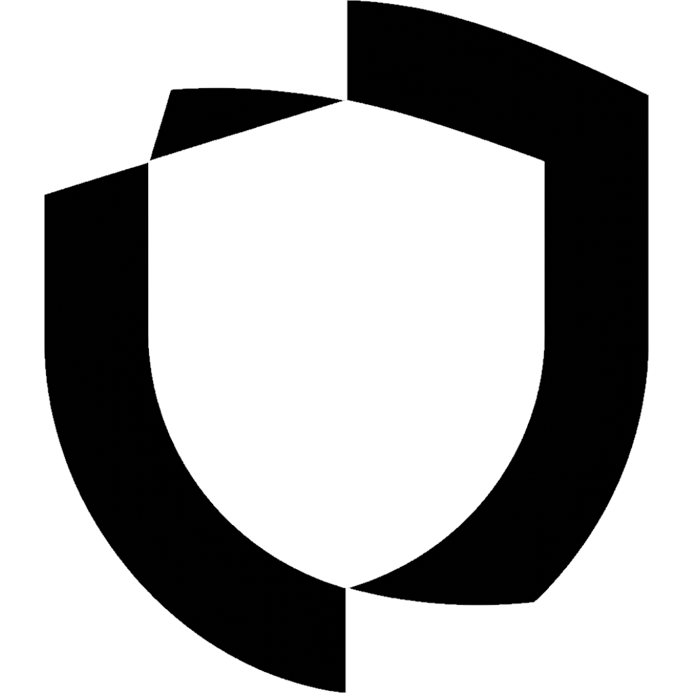

<p align="center">
  <picture>
    <source media="(prefers-color-scheme: dark)" srcset="logo_white.png">
    
  </picture>
</p>

# Dnoise

Chrome extension (Manifest V3) that hides propaganda, scam and phishing content on any website (X/Twitter posts, comments, forum replies, article blocks) element by element, like an ad blocker, with labels, a details view of predictions, and a "show anyways" button.

## Setup

Requires Node.js 20+.

```sh
npm install
npm run build      # or: npm run watch
```

Then open `chrome://extensions`, enable **Developer mode**, click **Load unpacked** and select the `dist/` folder.

## Connecting the AI service

Until an endpoint is configured the extension uses mock predictions. To connect a real service, open the extension's service worker console (`chrome://extensions` > Dnoise > service worker) and run:

```js
chrome.storage.local.set({ apiUrl: "https://your-endpoint", apiKey: "..." })
```

Each post's text and metadata is sent as JSON to `apiUrl`. The request and response shapes are defined in `src/backend/api/client.ts`. The manifest grants `host_permissions` for any `http`/`https` host so the extension can reach the VPS by IP.

The backend lives in [server/](server/): a small Node.js server for the Hostinger VPS. It detects propaganda with the Dnoise classifier on a Verda GPU container ([inference/](inference/)) and, for flagged posts only, asks an LLM on Verda's inference API to explain why. See [server/README.md](server/README.md) for deployment. Once it runs, point the extension at it:

```js
chrome.storage.local.set({ apiUrl: "http://<VPS-IP>:3000/api/classify" })
```

## Scripts

- `npm run dev`: start the local server & standalone web page (`server/public/index.html`) at `http://localhost:3000` with live reload
- `npm run build`: production extension build into `dist/`
- `npm run watch`: rebuild extension on change
- `npm run typecheck`: type-check extension TypeScript without emitting

## Structure

- `src/frontend/`: Chrome extension UI (popup, in-page overlay)
- `src/backend/`: Chrome extension logic (feed observer, detection, platform adapters, service worker)
- `src/shared/`: shared extension types and constants
- `server/public/`: standalone web page (`dnoise.tech`), separate from the extension
- `server/server.js`: classification backend (Hostinger VPS: Verda detector + Verda LLM explainer) and static web server
- `inference/`: Docker image of the propaganda classifier served on Verda

See [.agents/AGENTS.md](.agents/AGENTS.md) for architecture rules.
